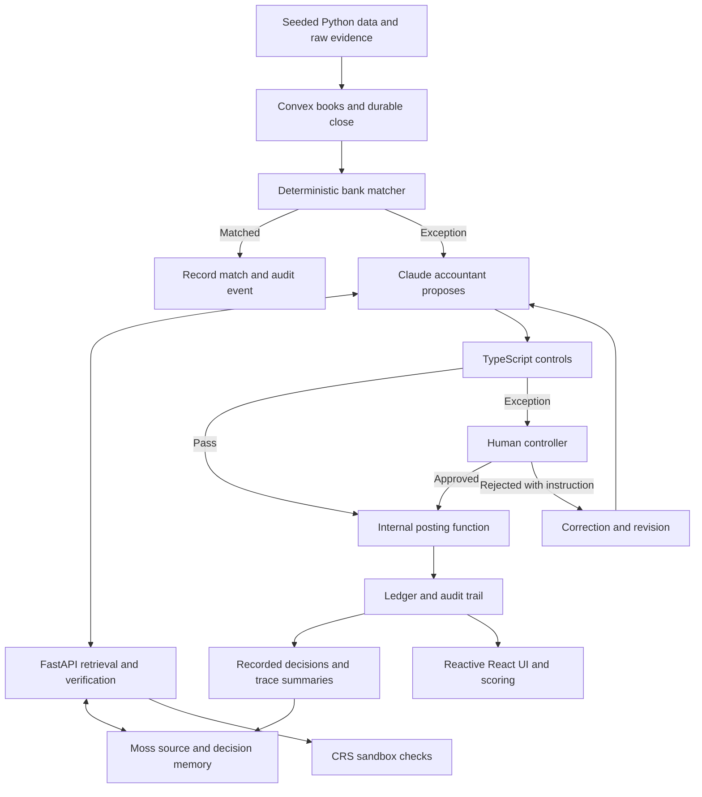

# Auditor · Hyphenate recruiter walkthrough

Prepared against `main` commit `af0311d`, pulled into `Deep`. Checked locally on October 24, 2026: **338 tests pass** (33 data, 39 retrieval/CRS, 266 TypeScript/UI), Convex type check passes, frontend production build passes. These are component/integration tests; this check did not run a new paid Claude close or mutate the shared deployment.

The current display company is **Coachella-inspired**. All financial data, contracts, vendors and policies in the benchmark are fictitious. The legacy internal entity ID is still `eo-festival-nyc`. Auditor is a hackathon prototype, not a claim of work for Coachella, Goldenvoice or AEG.

## 1. Your opening: learn this first

> “We built Auditor, an evidence-backed financial close system for a simulated festival business. It has three seats: a Claude staff accountant that investigates exceptions, a deterministic controls engine that decides what can be posted, and a human controller who handles exceptions and signs the close. I owned Data and Retrieval: reproducible financial fixtures, historical source retrieval, runtime decision memory, CRS sandbox verification, and scoring against an answer key. My focus was making the agent's inputs, evidence and measured outputs trustworthy.”

Use **we** for the team system and **I** for the components you owned. Your teammates built most of the agent, workflow, controls and frontend. Your cross-team work included fixing the agreed retrieval interface, auth/date/entity forwarding, cash-matcher semantics and scoring/reset integration.

## 2. The business problem in plain English

A festival has customer receipts, payment-processor payouts, supplier deposits, cancellation refunds, invoices and sponsorship revenue. Its bank statement, accounting ledger and contracts can disagree. A refund can be smaller than a deposit, an invoice can arrive twice, or an email can request a new vendor bank account immediately before payment.

Closing a period means checking the books, explaining differences, recording approved corrections, recording unresolved items and locking the period after controller sign-off. A balanced entry alone does not prove the treatment is right: a wrong receivable can balance just as neatly as a legitimate expense.

| Term | Meaning in this project |
|---|---|
| Bank transaction | Evidence of settled cash moving in or out. |
| Ledger / books | Recorded accounting entries, including deliberately incorrect imported entries. |
| Journal entry | Debits and credits that must balance; account choice and timing still need evidence. |
| Reconciliation | Comparing bank cash with recorded cash and investigating differences. |
| Break | An exception requiring investigation. Some cases are evidence-only and have no bank movement. |
| Precedent | A recorded earlier decision. Human approval matters; generated text does not create authorization. |
| Accrual | Recording a cost when service happened even if the invoice arrives later. |
| Materiality | The demo's threshold for routing P&L-impacting entries to human review. |

## 3. Architecture and the complete journey



1. Python produces a deterministic seed with books, bank transactions and dated evidence.
2. `convex/seed.ts` loads the target entity into typed tables. Seeding is an explicit replacement operation, not a normal user action.
3. A bank ingestion event or scheduled preparation can start the durable close. The UI also has an explicit prepare action for the demo.
4. The matcher checks exact signed cash amount, counterparty text and a three-day window. It uses account 1000, not payment-processor clearing account 1010.
5. Exceptions reach the Claude agent. It can retrieve policy, contract, precedent and correction evidence and propose an entry or request the controller's decision.
6. Deterministic rules evaluate the proposal. Fixable failures return for revision; control exceptions escalate; an eligible proposal can proceed to posting.
7. The internal posting mutation checks the caller/proposer boundary, the decision, balance and period lock, then records the entry and audit links.
8. Human approvals/rejections create durable records. Their published memory and audit summaries become available to later retrieval.
9. The UI subscribes to Convex state; a completed button request is not itself proof that an entry was posted.

The current close starts from unmatched bank rows and already-open breaks. An amendment can trigger another close, but triggering a run does not itself implement a complete revenue-schedule detector. The benchmark includes cases beyond automatically discovered bank mismatches.

## 4. What you personally built

| Your area | What to explain | Relevant files |
|---|---|---|
| Data contract and generator | Reproducible financial inputs, clean baseline, deliberately wrong books, dated evidence, schema compatibility. | `datagen/generate.py`, `phase2.py`, `seed.schema.json` |
| Validation | Integer cents, valid references and dates, balanced entries, scenario dependencies and accounting checks. | `datagen/validate.py`, data tests |
| Retrieval service | Actual ranked search with entity/date scoping and exact source resolution. | `retrieval/main.py`, `service.py`, `backends.py` |
| Durable memory and reset | Canonical SQLite catalog, runtime decisions/corrections/events, recoverable entity replacement. | `retrieval/store.py`, reset tests |
| CRS | Official sandbox personas, authentication, negative results, step-up flags, optional four-product summaries. | `retrieval/crs.py`, `crs_enrichment.py`, `crs_personas.json` |
| Evaluation | Detection versus correct posted treatment, dependency checks, false positives, estimated Impact. | `convex/scoring.ts`, `convex/scoring/metrics.ts` |
| Integration | OpenAPI, adapter response shapes, shared auth, trace headers, historical metadata and teammate handoff. | `retrieval/openapi.yaml`, `convex/retrievalClient.ts`, retrieval adapters/tests |

## 5. Why the dataset is more than random fake transactions

The current generated dataset has **368 bank transactions**, **12 payout reports**, **387 imported entries plus one opening entry**, **10 raw source documents**, **six break families**, and **11 period-specific cases** across July–September. It begins with 360 routine bank rows, then adds eight scenario cash movements. Monetary values are integer cents.

The errors remain plausible: the imported books balance even when their accounting is wrong; duplicate invoice references vary in formatting; amendments have real effective dates; and an unverified payment request is not misrepresented as settled bank cash.

| Family | Scenario and intended corrective treatment |
|---|---|
| 1. Stripe netting | July example: gross $48,600, bank $47,180, fee $1,420. The imported settlement already uses gross cash, so the corrective entry debits processing-fee expense and credits cash by $1,420. It recurs in August and September. |
| 2. Duplicate payable | SoundWave invoice SW-1042 / SW1042 arrives twice for $18,500. Reverse the duplicate AP/prepaid entry. The service is in September, so the July reversal has zero P&L impact. |
| 3. Deposit shortfalls | July artist: $60,000 receivable, $51,000 refund, $9,000 retained fee. September Apex: $16,000 deposit, $13,600 refund, $2,400 inspection fee. Different accounts/vendors, potentially reusable treatment after human approval. |
| 4. Sponsorship amendment | Fixed fee changes to $30,000 plus $2 per attendee, capped at $70,000. August needs a cumulative catch-up; September needs the remaining fixed/variable treatment. The generator states its 82-day proration assumption. |
| 5. Bank-detail change | Field & Flame requests a new account before a $42,000 payment. Keep a hold, verify the contact, ask the controller, and reclassify the unpaid advance into review suspense. There is no invented cash outflow. |
| 6. Missing accrual | $9,400 of August service is invoiced in September. Record the August accrual, then reverse it in September alongside the imported invoice treatment. |

There are 11 cases because families recur and some have a later dependent correction. The sponsorship generator computes an August correction of **$15,121.95**, differing from an approximate figure in the brief; that is a documented assumption requiring controller agreement, not a hidden arithmetic discrepancy.

The scoring answer key is kept away from the agent's retrieval corpus. Initial Python bootstrap indexes only policy and contract clauses: 21 chunks. A solution cannot earn meaningful evaluation credit by reading its expected answer.

## 6. Your strongest technical explanation: retrieval

> “I treated evidence selection as a correctness boundary. A source must belong to the entity and exist as of the close date before it can compete in search.”

- Documents carry a stable source ID, collection, original text, entity and effective date; optional validity bounds can expire them.
- Search first selects the eligible corpus. Moss ranks eligible sources, and the service checks returned IDs against the canonical allowed set again.
- `/resolve` looks up the exact source ID and returns its original text and metadata. An unavailable or future source gets 404.
- July 31 cannot resolve the Brightwater amendment signed August 10; August 31 can. This is protection against look-ahead bias in historical closes.
- The collections are `policy`, `contracts`, `decisions`, `corrections`, and `events`. An audit summary in `events` is not human approval precedent.
- Moss is the real semantic/hybrid backend. The local backend is explicitly labelled lexical search; cloud failures do not silently become local or canned answers.
- SQLite is the canonical local mirror and reset journal. It stores exact text/metadata, while Moss supplies remote durability and search ranking. Startup restores the cloud corpus and warms the model/index outside the query path.
- Indexing uses stable entity/collection/source keys and upserts. Bounded retries handle idempotent cloud writes. The service reports failures instead of claiming that an index update succeeded.

Useful endpoint explanations:

| Endpoint | Purpose |
|---|---|
| `GET /health` | Ready state, actual backend and document count; not a financial-correctness check. |
| `POST /query` | Ranked `{id,text,score}` array with entity and as-of scope. |
| `POST /resolve` | Exact citation resolution. |
| `POST /index`, `/index/batch` | Publish authoritative chunks and runtime memory. |
| `POST /reindex-all` | Replace one entity's complete snapshot and remove stale memory. |
| `GET /stats` | Successful retrieval count, latest-1,000 median latency, token estimates, verification status. |
| `POST /verify` | Identity/risk result, optionally with enrichment summaries. |

Top-k relevance is not confidence that an accounting treatment is correct. A millisecond search measurement is not a measure of total LLM/close time. Token counters use characters/4 estimates, not actual Claude billing.

## 7. The Apex story: show the accounting and the evidence

> “Apex returned $13,600 of a $16,000 deposit. The missing $2,400 could be misclassified as a recoverable receivable. The contract explicitly retains a 15% inspection fee, and policy governs its treatment. The system can retrieve an earlier human-approved non-recoverable-fee decision and propose the supported entry.”

| Line | Debit | Credit |
|---|---:|---:|
| Cash 1000 | $13,600 | — |
| Inspection expense 5160 | $2,400 | — |
| Vendor deposit 1200 | — | $16,000 |
| Total | $16,000 | $16,000 |

Fifteen percent of $16,000 is $2,400. The entry clears the original asset and explains the short cash receipt. Its eligibility for automatic posting also depends on the rules and actual approved precedent. Under $5,000 alone does not grant posting authority.

The July artist case has a $9,000 expense and requires human review. If that review is actually recorded and published, September can reuse the principle. `D-0417` in the isolated rehearsal is an explicitly synthetic fixture; do not describe it as a real controller approval unless the live deployment has one. Actual decision IDs may differ.

## 8. Controls, humans and memory

The engine is deterministic TypeScript and evaluates eight rules: balance, citation, period lock, correction handling, P&L threshold, vendor hold, revision cap and precedent. The posting boundary also enforces the proposer/caller restriction.

The demo's materiality calculation sums absolute movements on revenue/expense lines. It is not the bank amount or the model's confidence. Threshold failure and vendor holds escalate. Revision three escalates to prevent endless repair loops. The agent's explicit request for human approval now carries retrieved evidence and escalates rather than being treated as another routine repair.

The citation check verifies a whitespace-normalized substring against stored source text. It establishes quote provenance, not that the model's accounting conclusion is correct. The human still needs judgment for material or exceptional treatments.

Rejection stores a correction and reopens the break for revision. Approval records the decision and can publish precedent. Signing stores the close summary and locks the period; the latest code allows the controller to sign with explicitly carried unresolved items. A close can therefore be signed without every exception being resolved; the carried count remains visible.

“Learning” here means retrieval of recorded decisions and instructions. The model weights are not retrained. The current precedent rule compares break kind; richer policy/version/counterparty/jurisdiction/effective-date matching is production-hardening work.

## 9. CRS: successful request versus successful identity

The integration follows the sponsor's hackathon package, not the generic named-config example. It calls `/transunion/identity-manager-verification/basic` with the account default and maps P01–P20 to the supplied synthetic request bodies. No separate TruValidate config name is needed.

The standard result is `{identityMatch, fraudFlags, available}`. `available:true` means the check completed and was understood. It can still return an identity mismatch. Unknown identities, missing credentials, unsupported bodies and upstream failures keep verification unavailable. A failed login is not hammered repeatedly.

Previously verified live in this session: P01 clean; P12/P13 mismatch flags; P14 deceased flag; P16 basic match with a required step-up flag. Optional reports add Criminal, Fraud Finder and PitchPoint counts/risk summaries. P12 returned fraud score 85; P01 returned 11. The score-70 review threshold is a stated demo-routing assumption.

A clean consumer identity result does not prove destination bank-account ownership. The sidecar never releases a hold; the controller's callback decision remains a separate action. All these examples are sponsor personas, not real vendor screening results. The latest main now requests/stores the optional report on the vendor's trace.

## 10. Evaluation and defensible numbers

You can say: “I separated detecting a problem from actually correcting the books.”

- Detection uses links to real bank/evidence records, not planted flags. Duplicate alerts/revisions are deduplicated.
- Precision = detected labelled cases / (detected labelled cases + distinct unmatched alerts).
- Recall = detected labelled cases / labelled cases in scope.
- Correct treatment additionally requires posted, balanced, authorized corrective entries with exact account movements, expected control behavior and prior-case dependencies.
- All corrective postings for a case are summed: one good posting cannot hide another duplicate posting. Imported entries or a proposal marked posted earn no posting credit by themselves.
- Zero denominators are `null`, not invented perfect ratios. Live queries recompute from current records rather than trusting cached green results.

Example arithmetic only: 8 true detections, 2 false alerts and 3 misses gives precision 80% and recall 8/11 ≈72.7%. This is not an observed agent result.

The untouched seed scores zero corrections. The 11/11 oracle copies expected treatments into labelled synthetic fixtures to test the scorer. It is not Claude's measured accuracy. Similarly, the matcher fixture leaves five unmatched bank rows; that result does not prove all non-bank exceptions are detected.

Impact uses recorded activity plus visible time assumptions: 3 minutes/routine match, 15 minutes/exception, 5 minutes/controller review, 5-day manual-close baseline. Distinguish estimated hours from measured elapsed time, protected exposure from realized savings, and misclassification corrections from prevented cash loss. The repeat-mistakes counter measures repeated failures of the same recorded rule, not semantic compliance with every free-text instruction.

## 11. Latest main add-ons and their status

- Live UI callbacks now connect the injector, forbidden-call action and Ask Auditor to backend actions. The UI resolves external proposal codes and uses the selected record/date for answers.
- Audit summaries are indexed into `events` after closes/controller actions, enabling questions about a trace's actual recorded history.
- Public-source intake stores text, URL, publisher, source ID and date; public references can be indexed and checked as citations. Public pages do not turn synthetic amounts into real financial records.
- `/hooks/context` implements authenticated monitor-event intake. It checks a signature/shared token and routes `contract:<counterparty>` changes into amendment ingestion. A live monitor still requires configuration and a verified event delivery; code presence alone does not prove that external trigger is active.
- The scoring API exists, while the current drawer still labels full live time-saving/precision/recall metrics as unavailable. Use `scoring:report` for a checked result; do not imply the UI shows every backend metric.

The repository includes earlier public-host deployment notes, but this pull did not deploy updated code or reseed that host. Local code, a configured deployment and a complete live gate are separate facts.

## 12. Answers to likely follow-up questions

**Why not send all transactions to the LLM?** Exact routine matches are cheaper, predictable and testable in code. Use model reasoning where evidence needs interpretation. The measured fraction depends on the dataset.

**Why not put every document in the prompt?** That increases context, can expose irrelevant/future evidence and weakens traceability. Scoped retrieval selects a small eligible set with resolvable IDs. This is an architectural rationale, not a claimed measured cost percentage.

**What was your hardest bug?** Choose one you can explain in detail: including processor clearing in bank cash could cancel a legitimate payout; post-ranking date filtering could let future evidence crowd out valid hits; resetting books without removing old approvals could contaminate the next run; or a response-shape mismatch could make a working search look empty.

**How do you recover from an interrupted reset?** The Phase 3 service journals the target snapshot, blocks readiness/retrieval after failure, and replays pending replacement on restart. It removes stale target-entity cloud IDs while preserving other entities. Latest main also has a compatibility fallback to upsert when replacement fails; that fallback does not remove stale decisions. A production adapter should require a true replacement acknowledgement before claiming memory reset.

**What would you improve before production?** Authenticated user/tenant authorization at every API, posting idempotency and stronger write-boundary validation, source provenance and prompt-injection defenses, full effective-date/version matching for precedent, explicit reset acknowledgement, webhook deduplication, broader non-bank event discovery, pagination/aggregates, and end-to-end evaluation on withheld cases.

**Does this actually transfer money?** No payment rail is implemented. The demo posts accounting entries and manages simulated holds; cash transactions are synthetic inputs.

**Does 338 tests mean it is production-safe?** No. The suite supports specific invariants and integration contracts. It does not establish model accuracy, production security, real savings or a full live close across all benchmark cases.

**Did you use coding assistance?** Answer honestly if asked. Explain how you checked the accounting, reviewed interfaces, tested failure cases and made the engineering decisions; be ready to walk through and change your own components.

## 13. A three-minute presentation sequence

| Time | Show / say |
|---|---|
| 0:00–0:25 | Open the Apex shortfall. State your Data + Retrieval ownership and the three seats. |
| 0:25–1:05 | Show bank receipt, deposit, contract 15% clause, governing policy and the balanced proposed entry. Point to actual source IDs. |
| 1:05–1:35 | Demonstrate July/August historical resolution or explain the source eligibility boundary. |
| 1:35–2:00 | Show Field & Flame's hold and P12 verification/enrichment; explain why an available negative result is useful. |
| 2:00–2:20 | Show the agent-post denial and audit record. Describe the internal posting boundary accurately. |
| 2:20–2:45 | Show a retrieved explanation/audit trace or scoring report. Keep Demo/Live badges and fixture labels visible. |
| 2:45–3:00 | State the evidence: reproducible benchmark, exact-cents scoring, tested source isolation/failures, live SDK/sandbox checks. Invite a new scenario or a code walkthrough. |

Suggested closing: “I would be happy to walk through the retrieval failure path or take a new scenario and explain which evidence and control should decide it.”

This maps to the supplied Hyphenate rubric: realistic messy inputs and proof; defined seats/limited authority; decisions that persist across time; and a concrete moment where a short refund is explained from evidence.

## 14. Commands for rehearsal

From the repo root, use `corepack pnpm` if `pnpm` is not on PATH:

```bash
corepack pnpm data:generate
corepack pnpm data:validate
corepack pnpm scoring:demo
corepack pnpm retrieval:phase3
corepack pnpm retrieval:verify --persona P12 --report
```

The real Moss rehearsal is `corepack pnpm retrieval:phase3:moss`; it can take longer because it warms and mutates an isolated cloud rehearsal index. It does not run an actual Claude close. Start the service separately with `corepack pnpm dev:retrieval` for Swagger. `GET /health` alone does not prove the rest of the system.

Use `corepack pnpm scoring:report` only against the intended configured deployment with the matching functions/data. An actual close or seed changes shared state; coordinate those operations with the team rather than resetting during another person's demo.
