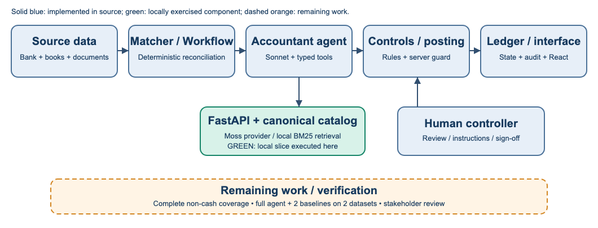
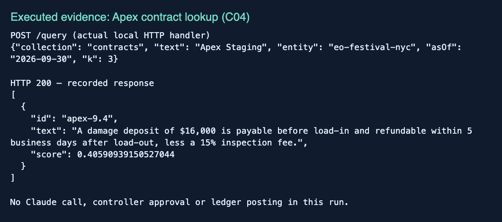

# Auditor — Capstone Milestone 2

Group report draft prepared by Deep Nayak • November 1, 2026 • Due November 8, 2026

DRAFT: Deep’s evidence and writing are prepared. Stakeholder meeting details, the group Milestone 1/proposal comparison, and full-system comparative evaluation must be supplied before the group submits one report.

## Basic Information

| Student | Email / status |
| --- | --- |
| Deep Nayak | deepnayak200@gmail.com — confirm course email |
| Christopher Lam | Team to confirm email |
| Prem Mahendra Pagare | Team to confirm email |
| Aarya Bhutkar | Team to confirm email |

Project: Auditor, a controlled agentic accounting-close prototype for one synthetic event-management entity. Stakeholder name: [TEAM INPUT]. Meeting date and participants: [TEAM INPUT].

## Section 1  Stakeholder Follow Up and Final Deliverables

No stakeholder meeting record was available in the provided materials. The assignment requires an actual review; repository implementation and demo fixtures do not establish that it occurred. The group must add the date, participants, presented behaviors/results, and brief notes or an appendix.

| Feedback | Team response | Next action |
| --- | --- | --- |
| [Actual stakeholder feedback] | [Actual response or reason for retaining design] | [Owner and agreed next action] |
| [Needs still unmet] | [Effect on scope / success criteria] | [Stakeholder-confirmed deliverable] |

Proposed deliverables for confirmation: a runnable repository, source-linked proposals with independent controls and controller review, synthetic evaluation data plus baseline comparisons, an actual close demonstration, and a final report/presentation. These are proposed rather than stakeholder-approved. Confirm task coverage, acceptable false alerts, correction accuracy, review burden, and the demonstration’s completion criteria.


<!-- page break -->

## Section 2  Implemented Agentic System

Inputs are bank movements, imported journal entries, contracts, policy clauses, and vendor records scoped by entity and accounting period. The durable Convex workflow fetches unmatched bank rows, reconciles against books, investigates breaks, reviews proposals, and posts eligible entries. The React interface exposes records and controller decisions. Amounts are integer USD cents; all financial data are fictitious.



| Mechanism | When used; state read or changed; effect |
| --- | --- |
| Deterministic reconciliation | Exact bank cash amount, counterparty, ±3 days against imported books. Matches update status and audit; unmatched rows become breaks for investigation. |
| One accountant agent | Reads break/transaction and retrieved context; chooses typed search, ledger/contract inspection, proposal, or approval request. Proposal/citations become durable records. |
| Independent controls | Checks balance, citation provenance, P&L threshold, bank hold, period lock, correction history, precedent scope and revision cap. Routes to posting, return or human review. |
| Controller | Reviews escalations and gives approval/rejection instructions; signs the period. Decisions and corrections become searchable memory after runtime publication. |

This is one LLM role coordinated with deterministic services and a human. “Three seats” does not mean three LLM agents. A retrieval-only run does not demonstrate that the entire workflow completed.


<!-- page break -->

## Section 2  Implementation Details and Evidence Boundary

The active proposal action in convex/agent.ts calls the Vercel AI SDK generateText with Anthropic, default model claude-sonnet-4-5, temperature 0, and a 12-step stop condition. ANTHROPIC_MODEL can override the model. The Convex Agent component is mounted in configuration, but the active proposal path uses generateText; persistent agent-thread execution is not established by that registration.

FastAPI provides /query, /resolve, indexing, readiness and statistics. Moss is the external retrieval provider; SQLite stores canonical chunks and a reset journal. The explicit local backend uses BM25-style lexical ranking. Policy/contracts bootstrap via an allowlist; answerKey, planted flags and expected journal entries are excluded. Runtime decisions, corrections and audit events have separate collections. Entity/effective-date filtering precedes ranking; exact canonical text supports citation checks.

Recovery includes bounded retries for idempotent retrieval writes, readiness failures during incomplete snapshot replacement, replay of pending resets on startup, and workflow proposal revisions. CRS sandbox errors fail closed and do not release a payment hold. Posting is guarded server-side against the agent identity and self-approval. These mechanisms are inspected in source and exercised by tests; no new hosted close or live CRS/Moss result is claimed here.

Changes since Milestone 1 cannot be verified because the group’s Milestone 1 report and selected stakeholder proposal were not supplied. Repository history shows progression from a clean generator/fake-agent gate to six scenario families, real retrieval adapters, scoring, holds and controller UI. The group must compare those changes against its actual Milestone 1 commitments. Deep’s available individual course-policy-assistant proposal describes a different project and is not treated as Auditor’s group baseline.

## Section 3  Preliminary Evaluation: Setup

| Dataset | Source, task and evaluated size |
| --- | --- |
| Policy pilot v1 | 12 hand-written source-ID questions over 12 synthetic policy clauses: 9 answerable, 3 negative. Tests policy evidence retrieval, entity/date bounds and unsupported requests. |
| Contract pilot v1 | 12 hand-written source-ID questions over 9 clauses in 6 synthetic contracts: 9 answerable, 3 negative. Tests vendor lookup, amendment timing and unsupported requests. |

The pilots share one 21-document project corpus and are not independent public benchmarks. Labels were fixed before successful ranking runs, with one invalid source ID corrected during preflight validation. No train/test split, independent annotator or held-out-generalization claim is made. No ranker was changed or tuned on these results.


<!-- page break -->

## Section 3  Measured Results and Analysis

Baseline 1 is cosine TF-IDF over clause text, title and ID, filtered by collection but ignoring entity/date. Baseline 2 applies entity/effective-date filtering to the same TF-IDF method. Auditor local uses the existing FastAPI /query, SQLite catalog, scoped local BM25-style backend, and contract-title narrowing. The proposed full agentic system is not counted as a baseline.

All three methods receive identical examples and corpus, return up to three positive-score hits, and run once per example in fixed order: 24 questions × 3 methods = 72 executions. No LLM, cloud provider, human scoring, controller action or payment is involved. Latency excludes startup/indexing/network/model calls; only Auditor includes in-process HTTP routing. Timing is descriptive and cannot establish a fair speed ranking.

| Data | Method | Top-1 | Hit@3 | Abstain | Success | Scope* | ms† |
| --- | --- | --- | --- | --- | --- | --- | --- |
| Policy | Unscoped TF-IDF | 9/9 | 9/9 | 0/3 | 9/12 | 3 | 0.159 |
| Policy | Scoped TF-IDF | 9/9 | 9/9 | 2/3 | 11/12 | 0 | 0.154 |
| Policy | Auditor local | 9/9 | 9/9 | 2/3 | 11/12 | 0 | 0.667 |
| Contract | Unscoped TF-IDF | 9/9 | 9/9 | 0/3 | 9/12 | 5 | 0.119 |
| Contract | Scoped TF-IDF | 9/9 | 9/9 | 1/3 | 10/12 | 0 | 0.108 |
| Contract | Auditor local | 9/9 | 9/9 | 1/3 | 10/12 | 0 | 0.639 |

Top-1 and Hit@3 use the 9 answerable questions per dataset. Abstain uses the 3 negatives and requires a successful empty response. Success uses all 12: a valid expected first source, or correct abstention. *Scope counts returned hits violating entity/date, not questions. †Median wall time. All 72 executions completed without errors; returned texts matched canonical sources.

Auditor local succeeds on 11/12 policy and 10/12 contract questions. It ties scoped TF-IDF on these task metrics. Scoping removes the unscoped baseline’s temporal/entity leakage, while the mostly source-worded positives leave little room to differentiate rankers. This is evidence for the scope boundary, not an LLM reasoning or semantic-retrieval advantage.

Auditor returns irrelevant sources for P12, C10 and C12 rather than abstaining. It excludes the future amendment in C10 correctly but still returns other clauses. The current positive-score cutoff does not establish answerability. Scores are not calibrated confidence.

Required full-system table remains pending: run Auditor and two actual task baselines on the same examples in at least two accounting datasets. Suggested comparisons are the existing matcher-only path and a fixed single-pass proposer with the same model, tools, controls and human-review rules. Use the current 11-case synthetic scenario set plus an independently labeled held-out set. Record case detection, exact posted correction, hold/escalation correctness, tool errors, model usage and close latency. The retrieval table alone does not fulfill that whole-system requirement.


<!-- page break -->

## Section 4  Actual Demonstration: Retrieval Slice

Task: locate the authoritative Apex contract passage when investigating a synthetic $16,000 deposit returned as $13,600. The source data imply a $2,400 shortfall; the retrieval demonstration’s expected output is the exact contract passage, not an approved journal entry.

Execution: the evaluator generates the current seed, indexes only its 21 policy/contract clauses into a fresh temporary catalog through POST /index/batch, and invokes the real POST /query handler. C04 supplies collection=contracts, text=Apex Staging, entity=eo-festival-nyc, asOf=2026-09-30 and k=3. Entity/date filtering and the vendor-title path select the relevant contract. The returned top source is apex-9.4 with its original deposit and inspection-fee text.



The policy pilot separately retrieves policy-5.1 for non-recoverable deductions. Together these outputs supply evidence the accountant agent could use in its subsequent proposal. The screenshot corresponds to the retrieval box in Figure 1. Persisted canonical source text enables later exact citation resolution; storing evidence is distinct from approving an accounting treatment.

Observed final output: the required source passage is retrieved correctly for this slice. No actual controller decision, D-0417 precedent, ledger posting or period sign-off was created by this experiment. Before submission the group must add an integrated current-system trace and readable screenshots showing proposal → controls → posting/escalation and the actual final outcome.

Historical context only: retrieval/VULTR.md records an October 24 sample close with 3 breaks, 3 escalations and 0 posts, despite correct Apex proposed lines. That dated handoff is not rerun evidence or proof that the latest branch still has the same failure.


<!-- page break -->

## Section 5  Failure Analysis and Current Limitations

| Observed case and evidence | Diagnosis; proposed fix and check |
| --- | --- |
| P12: “cryptocurrency tax policy” returns policy-8.1, policy-1.0 and policy-9.0. No expected source exists. | Observed retrieval false acceptance. Generic word overlap is sufficient for positive scores. Develop an answerability/abstention rule on a separate development set; validate false accepts and retained positive recall on held-out questions. |
| C10: asks about the August amendment as of July. Returns northern-lines-3.1, soundwave-2.1 and brightwater-3.1; excludes the amendment. | Temporal isolation works; semantic abstention fails. Metadata-safe hits are not necessarily relevant answers. Test whether retrieved text answers the requested fact, with dated negative controls. |
| C12: “catering cryptocurrency insurance” returns field-flame-5.1. | Observed topical overlap without the requested provision. Add unsupported-topic and mixed-topic negatives; compare reranking or explicit evidence sufficiency. Do not infer a generative hallucination from this retrieval-only run. |

The evidence is preserved per query in evaluation/milestone2/results/results.json. The mechanism explanation is supported by the current lexical backend’s score>0 rule; the experiments do not isolate every causal contribution. No fix was applied to production ranking, so these remain current observed limitations.

A separate integration risk concerns task coverage. The dataset contains 368 bank rows, 387 imported entries, 10 raw source documents and 11 cases in six families. The tested bank matcher leaves five cash mismatches, but duplicate payables, amendment accounting, bank changes and accruals require document/book/event paths as well. A fresh full close must demonstrate coverage of every labeled case; bank-match percentage is not accounting-case recall.

The financial answer key assumes an 82-day inclusive sponsorship campaign and a $15,121.95 cumulative August correction, differing from the brief’s approximate amount. Controller/stakeholder review remains necessary before interpreting agent disagreement as error. Expected corrections and oracle scorer fixtures validate the dataset/scorer, not agent performance.

Broader limits: one synthetic USD entity, a tiny unblinded retrieval pilot with mostly lexical positives, no public benchmark or current full-agent comparative run, and external-service/configuration dependencies. Tokens estimated from characters are not measured model billing. Estimated time/exposure reductions are not realized savings. App seat checks do not by themselves establish production user authentication; no production security assessment is claimed.


<!-- page break -->

## Section 6  Remaining Work Before Final Submission

Owners below are proposed from repository responsibilities and need team agreement. Required items take priority over optional extensions; a week-by-week schedule is not assumed.

| Priority / gap | Planned work and proposed owner | Completion evidence |
| --- | --- | --- |
| Required: stakeholder review | Whole group; stakeholder liaison to be named. Present current behavior, measured results, failures and deliverable scope. | Actual dated notes, Feedback → Response → Next action, and agreed functionality/success criteria. |
| Required: Milestone 1 continuity | Christopher + whole group. Supply group Milestone 1 and selected proposal; reconcile scope, architecture and evaluation changes. | Explicit before/after comparison and justified scope decisions. |
| Required: accounting labels | Deep + controller. Review sponsorship proration, case annotations, dependencies and unsupported-query labels. | Reviewed expected outcomes; label corrections versioned before final tests. |
| Required: complete source coverage | Prem + Christopher. Verify document/event handling alongside bank-trigger workflow; address all missing paths. | Actual full-close trace links all 11 cases to raw evidence; no labels supplied to the agent. |
| Required: full-system comparison | Deep builds harness/data; Prem/Christopher run agent/baselines; group reviews labels. | Two baselines and Auditor on the same two accounting datasets, per-case outputs and actual result table. |
| Required: real memory and review | Christopher + Prem; Aarya captures UI. Run July review, publish actual decisions/corrections, then September transfer. | Actual decision IDs, source citations, posting/hold outcomes, revision history and human sign-off. |
| Required: finish evaluation limits | Deep + group. Add held-out paraphrases/negatives, independent labels, repeated nondeterministic runs and service failure trials. | Report sample counts, budgets, error groups, model usage and end-to-end latency with uncertainty. |
| Required: group submission package | Deep drafts report; Aarya prepares screenshots; whole group confirms contributions and grader access. | One 5–10 page report, reproducible setup, current branch/commit, final slides and actual demonstration. |
| Optional after required work | Whole group: second entity/currency, broader public data, voice polish and extra risk enrichment. | Demonstrated benefit without weakening controls or delaying required evidence. |

This contribution is complete as a Deep-branch draft and reproducible component-evaluation package. The group assignment remains incomplete until the required stakeholder, continuity and full-system evidence above is added. The source snapshots and current pilot should be retained when extending experiments.


<!-- page break -->

## Section 7  GitHub Repository and Team Contributions

Repository: https://github.com/Christopher4113/Auditor. Branch: Deep. Evaluated code and pilot harness commit: ef07a1325a98f8a0c10fc4eb9831bd6f6a182dd2. This report accompanies that reproducible code snapshot; the artifact commit is recorded in git history. Confirm the grader has repository access before submission.

| Member / GitHub | Actual contributions supported by history | Representative evidence |
| --- | --- | --- |
| Deep Nayak / Deep-nayak007 | Seed/schema/validator; six scenario families and answer key; scoped retrieval/Moss adapter; scoring/reset/CRS lane; current retrieval pilots, evidence package and report draft. | 92e7571; 2782fa3; 379b47c; 22def4c; ef07a13 |
| Prem Mahendra Pagare / prempagare07 | Tool schemas and seat permissions; matcher and model proposer; deterministic controls; bank-hold guard; retrieval-grounded Ask Auditor. | 07bcc44; 8f30503; acccebb; 3a624e5; e451f81; a67c387 |
| Christopher Lam / Christopher4113 | Backend/schema/workflow integration; human decisions, injection/audit paths; public-source and integration work; team merges. | a760d60; 14971b9; 91f9771; 863b3a2; f962ed8 |
| Aarya Bhutkar / AaryaBhutkar | React workspace and source/review interface; controller drawers; deployment handoff describing actual sample-close limitations. | 2d38fd2; b42f6a4; 24c0b02; 40c2466 |

[Deep: data / retrieval](https://github.com/Christopher4113/Auditor/commit/2782fa3) • [Deep: pilot](https://github.com/Christopher4113/Auditor/commit/ef07a1325a98f8a0c10fc4eb9831bd6f6a182dd2) • [Prem: controls](https://github.com/Christopher4113/Auditor/commit/acccebb) • [Christopher: integration](https://github.com/Christopher4113/Auditor/commit/14971b9) • [Aarya: interface](https://github.com/Christopher4113/Auditor/commit/40c2466)

Histories identify implementation evidence, not effort by commit count. Dataset preparation, local verification and writing in this package are documented directly. Stakeholder communication and other non-code work are not attributed without team confirmation. The group must confirm contact details and any additional members.

## Setup and reproduction

```sh
corepack pnpm install --frozen-lockfile
uv sync --locked --project retrieval
uv run --project retrieval python evaluation/milestone2/evaluate.py
uv run evaluation/milestone2/build_report.py
```

The evaluation needs Python 3.12+ and uv; no credentials. The app additionally needs a selected Convex development deployment and model/retrieval configuration described in README.md. Configure those services deliberately before a live close; this report’s reproduction commands do not reset or deploy shared data.

## Validation and evidence index

November 1 local checks: data 33 tests, retrieval 39, repository Vitest 266, evaluator 3: 341 passed. Convex/frontend TypeScript and frontend production build passed. The convenience typecheck script initially failed because nested pnpm was not on PATH; direct corepack invocations passed. Tests are regression evidence, not the full-system result table.

Evidence: evaluation/milestone2/results/results.json and execution.txt; docs/milestone2/verification.md; datagen/README.md; retrieval/PHASE3.md; source files convex/agent.ts, close.ts, controls/rules.ts and ledger.ts. Local assignment template is preserved as template.docx. The original template’s seven sections are retained; missing group facts are explicitly marked.
